<picture><source media="(prefers-color-scheme: dark)" srcset="assets/hero-dark.svg"></picture>

<picture><source media="(prefers-color-scheme: dark)" srcset="assets/social-l-dark.svg"></picture><a href="https://github.com/gicziunicorn"><picture><source media="(prefers-color-scheme: dark)" srcset="assets/social-1-dark.svg"></picture></a><picture><source media="(prefers-color-scheme: dark)" srcset="assets/social-r-dark.svg"></picture>

<picture><source media="(prefers-color-scheme: dark)" srcset="assets/about-dark.svg"></picture>

<picture><source media="(prefers-color-scheme: dark)" srcset="assets/stack-dark.svg"></picture>

<a href="https://github.com/gicziunicorn/WaifuFetcher"><picture><source media="(prefers-color-scheme: dark)" srcset="assets/project-waifufetcher-dark.svg"></picture></a>&nbsp;<a href="https://github.com/gicziunicorn/Waifu-API-rs"><picture><source media="(prefers-color-scheme: dark)" srcset="assets/project-waifu-api-rs-dark.svg"></picture></a>

<a href="https://github.com/gicziunicorn/Catgirl-website"><picture><source media="(prefers-color-scheme: dark)" srcset="assets/project-catgirl-website-dark.svg"></picture></a>&nbsp;<a href="https://github.com/gicziunicorn/kviz"><picture><source media="(prefers-color-scheme: dark)" srcset="assets/project-kviz-dark.svg"></picture></a>

<picture><source media="(prefers-color-scheme: dark)" srcset="assets/stats-dark.svg"></picture>

<picture><source media="(prefers-color-scheme: dark)" srcset="assets/wave-dark.svg"></picture>

<a href="https://giczidani.mooo.com"><picture><source media="(prefers-color-scheme: dark)" srcset="assets/button-1-dark.svg"></picture></a>&nbsp;&nbsp;<a href="https://github.com/gicziunicorn?tab=repositories"><picture><source media="(prefers-color-scheme: dark)" srcset="assets/button-2-dark.svg"></picture></a>

<a href="https://metawka.github.io/expressive-profile/?from=gicziunicorn"><picture><source media="(prefers-color-scheme: dark)" srcset="assets/credit-dark.svg"></picture></a>

